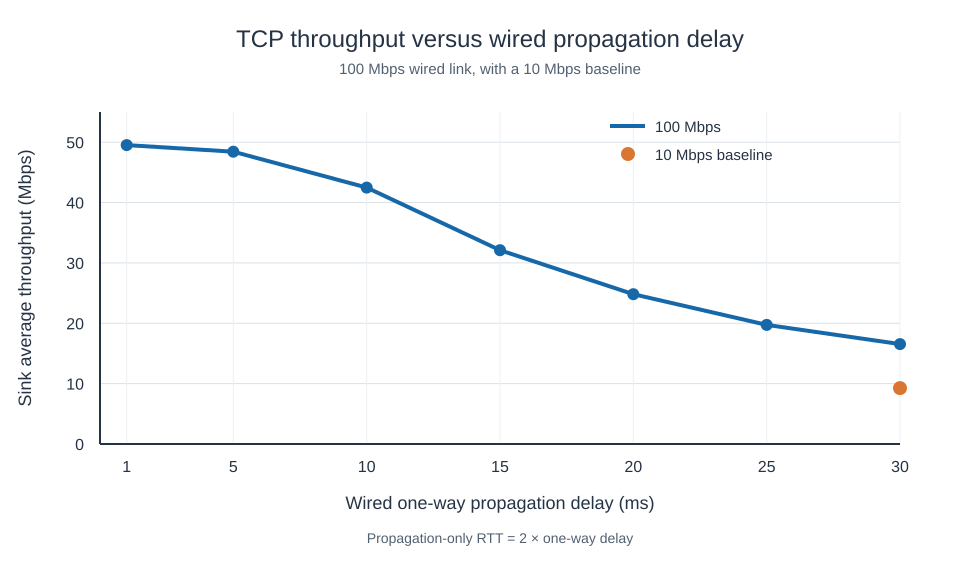

# TCP throughput across a Wi-Fi and wired path

This ns-3.47 experiment measures how wired propagation delay affects the
application throughput of a TCP NewReno sender on a three-node path. It also
compares a 10 Mbps wired link with a 100 Mbps link at the same 30 ms delay.

```text
Wi-Fi client 10.1.2.2 -- 802.11n -- access point/router
                                  10.1.2.1 (Wi-Fi), 10.1.1.1 (wired)
                                 -- point-to-point -- remote sink 10.1.1.2:9
```

The client and access point use fixed positions and a constant `HtMcs7` Wi-Fi
data mode. The TCP application offers 100 Mbps with 1472-byte payloads, starts
at simulation time 1 s, and runs until the simulation stops at 11 s. The
reported metric is the sink's total application bytes received, multiplied by
8 and divided by 10 s and 1,000,000 to give Mbps. Each setting was run once.

The RTT column counts **only** the wired link's propagation in both
directions: `2 × one-way delay`. Actual TCP RTT also includes transmission,
wireless channel access, and other delays.

| Wired rate (Mbps) | One-way delay (ms) | Propagation-only RTT (ms) | Sink throughput (Mbps) |
| ---: | ---: | ---: | ---: |
| 10 | 30 | 60 | 9.26536 |
| 100 | 30 | 60 | 16.5488 |
| 100 | 25 | 50 | 19.7224 |
| 100 | 20 | 40 | 24.8167 |
| 100 | 15 | 30 | 32.1108 |
| 100 | 10 | 20 | 42.4749 |
| 100 | 5 | 10 | 48.4312 |
| 100 | 1 | 2 | 49.5110 |



At 30 ms, raising the wired rate from 10 to 100 Mbps increases the sink
average from 9.26536 to 16.5488 Mbps. With the wired rate held at 100 Mbps,
reducing delay from 30 to 15 ms nearly doubles throughput. The products of
throughput and propagation-only RTT at 30, 25, and 20 ms are about 0.99 Mbit,
consistent with a finite amount of data in flight at longer RTTs. The curve
approaches 50 Mbps by 5 ms; reducing delay further to 1 ms adds only
1.0798 Mbps. The Wi-Fi path is a plausible limit at that point, though these
runs do not isolate every source of overhead.

The values in [the data file](../data/tcp-propagation.csv) are measurements,
not a fitted model. They were collected on 2026-11-03 with an externally
supplied ns-3 topology program, whose source is retained outside this
repository; its SHA-256 is
`47d624e066237a497874ea819f0d50353fb2191d76924d6e8e749157547eadeb`.
The Wi-Fi mode and topology differ from this repository's distance sweep, so
their throughput values should not be treated as matched measurements.

The figure can be regenerated from the CSV with `python3 tools/plot_tcp_propagation.py`.
